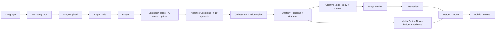

# AutoMarkAI → Real Estate Customization — Analysis

## Project Architecture Summary

AutoMarkAI is a **LangGraph-based campaign generation pipeline** with a **Next.js chat-style frontend** and a **FastAPI backend**. The flow is:



**Key technical details:**
- Backend pipeline: LangGraph `StateGraph` with `MemorySaver` checkpointing and `interrupt()` for human-in-the-loop
- Frontend: Next.js + Framer Motion, single `useCampaignChat` hook drives all phases
- LLM routing: Gemini for vision/orchestrator, Groq for text generation (strategy/creative/media)
- i18n: Full English/Arabic support via `templates/locales/`
- Meta publishing: Real API (facebook-business SDK) + simulation mode

---

## Analysis of Your Proposed Edits

### 1. ✅ Remove the "Marketing Type" Question (product/service/business)

**Verdict: VALID — absolutely correct.**

Since we're hardcoding the domain to **real estate agency**, the `marketing_type` selection (`"product" | "business" | "service"`) becomes unnecessary. The current system uses `marketing_type` in three places:

| Where | What it does | Impact of removing |
|-------|-------------|-------------------|
| [i18n.py](file:///d:/work/NTI/FinalProject_AutoMarkAI/AutoMarkAi/backend/i18n.py) | Picks different prompt templates per type | We'll use **one** real-estate-specific set of prompts |
| [state.py](file:///d:/work/NTI/FinalProject_AutoMarkAI/AutoMarkAi/backend/state.py#L19) | `marketing_type` field in state | Can be hardcoded to `"real_estate"` |
| [Composer.tsx](file:///d:/work/NTI/FinalProject_AutoMarkAI/AutoMarkAi/frontend/components/Composer.tsx#L71-L77) | `marketing_type` phase | Remove this phase entirely |
| [useCampaignChat.ts](file:///d:/work/NTI/FinalProject_AutoMarkAI/AutoMarkAi/frontend/hooks/useCampaignChat.ts#L275-L283) | `chooseMarketingType` callback | Remove |

**Implementation approach:** Hardcode `marketing_type = "real_estate"` in the backend, skip the phase in the frontend, and create real-estate-specific prompt templates.

---

### 2. ✅ Remove AI Photo Enhancement — Use Original Photos Only, Support Multiple Uploads

**Verdict: VALID — and your reasoning is correct for real estate.**

In real estate, buyers want to see **actual unit photos** — AI-enhanced or generated images would be misleading and could damage trust. This means:

- **Remove**: The `image_mode` selection phase (`"use_original"` / `"enhance_with_ai"` / `"generate_with_ai"`)
- **Remove**: All AI image generation/enhancement logic in [creative.py](file:///d:/work/NTI/FinalProject_AutoMarkAI/AutoMarkAi/backend/nodes/creative.py#L93-L111) (`enhance_ad_image`, `generate_ad_images`)
- **Remove**: The image regeneration loop ([image_regen_node](file:///d:/work/NTI/FinalProject_AutoMarkAI/AutoMarkAi/backend/nodes/review.py#L152-L192), [image_review_node](file:///d:/work/NTI/FinalProject_AutoMarkAI/AutoMarkAi/backend/nodes/review.py#L62-L146), [image_pick_node](file:///d:/work/NTI/FinalProject_AutoMarkAI/AutoMarkAi/backend/nodes/review.py#L198-L230))
- **Add**: Multi-photo upload capability (the current system only accepts **one** image)

**What changes:**
- Frontend [ImageUpload.tsx](file:///d:/work/NTI/FinalProject_AutoMarkAI/AutoMarkAi/frontend/components/steps/ImageUpload.tsx): Needs to support multiple file selection
- Backend [api.py](file:///d:/work/NTI/FinalProject_AutoMarkAI/AutoMarkAi/backend/api.py#L219-L264): `/start` endpoint needs to accept multiple images
- State: `image_path: str` → `image_paths: list[str]`
- Pipeline: The entire image review loop (regen/pick) can be **simplified** to just showing uploaded photos and letting the user pick which ones to use in the ad

> [!IMPORTANT]
> The user should still be able to **preview and select** which of their uploaded photos they want in the ad. Don't remove photo review entirely — just remove the AI generation part.

---

### 3. ✅ Curate Questions from the Media Buying File — Keep Only Critical Ones

**Verdict: VALID — but needs careful selection.**

Your [mediaBuyingQuestionsAndDocs.txt](file:///d:/work/NTI/FinalProject_AutoMarkAI/AutoMarkAi/data/mediaBuyingQuestionsAndDocs.txt) has **9 sections with 50+ questions**. That's way too many for a good UX. Here's my analysis of what to **keep**, **simplify**, or **drop**:

#### Questions to KEEP (Critical for campaign success):

| # | Question | Why it's essential | Format |
|---|----------|-------------------|--------|
| 1 | **What is the main goal of this campaign?** | Directly maps to Meta `objective` field. Already handled as the campaign_target step. | Options: Lead generation / Brand awareness / Sales / Event registration |
| 2 | **What's the compound name?** | Required for ad copy, branding, and the `real_estate_project.compound_name` field | Free text |
| 3 | **Where is it located?** | Required for geo-targeting (`ad_set.targeting.locations`) | Free text (or location picker) |
| 4 | **What types of units are available?** | Needed for ad copy and targeting | Multi-select: Apartment / Villa / Duplex / Townhouse / Twin House |
| 5 | **Starting prices?** | Critical for ad copy and audience segmentation | Free text or range slider |
| 6 | **Payment plans? (Down payment + installments)** | Core selling point in Egyptian real estate | Structured: Down payment % + installment years |
| 7 | **Do you currently have an offer?** | Every successful real estate ad needs an offer | Options: 5% Down / Zero Down / Limited Units / Free Membership / Discount / Other |
| 8 | **Monthly budget?** | Already collected as `budget`, but campaign duration is also needed | Already exists |
| 9 | **Campaign duration?** | Needed for `daily_budget = budget / duration` and `start_date`/`end_date` | Options: 1 week / 2 weeks / 1 month / Custom |

#### Questions to SIMPLIFY or MAKE OPTIONAL:

| # | Question | Recommendation |
|---|----------|---------------|
| Target audience details (age, gender, income) | **Auto-infer** from unit type + price range. Luxury villa → 35-60, male-heavy, high income. Apartment → 25-45, all genders. Let AI determine, but let user override. |
| Competitors | **Drop** — low value for the UX cost. The AI can position the ad without this. |
| Sales process (where leads go, CRM, etc.) | **Simplify** to one question: "Where should leads go?" with options: WhatsApp / Phone Call / Instant Form / Landing Page. This maps directly to `ad_set.conversion_location`. |
| Previous campaigns data | **Drop from questions** — instead, offer an optional file upload for "Previous campaign report" |
| KPIs (CPL, CTR, etc.) | **Drop** — too technical for the user. The AI can set reasonable KPI targets based on budget and market data. |

#### Questions to DROP:

| Question | Why |
|----------|-----|
| "How many units are you planning to sell?" | Too internal, doesn't affect ad configuration |
| "What is considered a successful campaign?" | Redundant with campaign goal |
| "Who calls the leads? How fast? How many agents?" | Internal sales ops — not relevant to Meta ad setup |
| "Why would someone buy here?" / "What makes it different?" | Can be auto-inferred from compound details + offer |
| "Which companies do you admire?" | Not actionable for campaign setup |
| "Family size?" / "Married or single?" | Over-targeting, and Meta's HOUSING category restricts these anyway |

> [!WARNING]
> **Meta's Special Ad Category: HOUSING** restricts targeting options. You **cannot** target by age (must be 18-65+), gender, ZIP code, or multicultural affinity. Many of the audience questions from the file are **not applicable** because Meta won't let you use them. Your JSON schema correctly sets `special_ad_category: "HOUSING"` — we need to respect this in the questions we ask.

---

### 4. ✅ Use the JSON Schema to Guide Question Design

**Verdict: VALID — great approach.**

Your [meta_real_estate_campaign_schema.json](file:///d:/work/NTI/FinalProject_AutoMarkAI/AutoMarkAi/data/meta_real_estate_campaign_schema.json) maps nicely to what we need to collect. Here's how user questions map to schema fields:

| Schema Field | Collected From | User Question |
|-------------|---------------|---------------|
| `campaign.objective` | Campaign target step (AI-ranked options) | "What's the main goal?" → LEADS |
| `campaign.daily_budget` | Budget + Duration | Auto-calculated |
| `campaign.start_date` / `end_date` | Duration question | "When do you want to start?" |
| `ad_set.targeting.locations` | Compound location | Auto-derived from compound location |
| `ad_set.targeting.minimum_age` / `maximum_age` | ⚠️ HOUSING limits to 18-65 | Auto-set (18-65, cannot customize) |
| `ad.primary_text` / `headline` | AI-generated (creative node) | Not asked — generated |
| `ad.call_to_action` | Lead destination question | Derived from conversion_location |
| `ad.media.images` | Multi-photo upload | User uploads |
| `real_estate_project.*` | Compound questions | Direct mapping |
| `client_assets.*` | File uploads | Upload step |
| `kpis.*` | **Don't ask** — auto-set by AI | Based on budget + market benchmarks |

> [!TIP]
> The questions should be designed to **fill the schema** without the user ever seeing the schema. The AI maps natural answers to technical fields.

---

### 5. ✅ Options + Recommendations + "Other" for Every Question

**Verdict: VALID — excellent UX principle.**

This is exactly the right approach. For each question:
1. Show **options** derived from context (e.g., unit type options based on common Egyptian real estate)
2. Mark one as **"Recommended"** based on previous answers and AI analysis
3. Always include an **"Other"** option with a free-text input

This already partially exists in the codebase — the `campaign_target` step uses [CampaignTargetCards](file:///d:/work/NTI/FinalProject_AutoMarkAI/AutoMarkAi/frontend/components/steps/CampaignTargetCards.tsx) with recommendations. We need to extend this pattern to all questions.

**Current limitation:** The adaptive question system in [question_gen_node](file:///d:/work/NTI/FinalProject_AutoMarkAI/AutoMarkAi/backend/nodes/question_generator.py#L168-L226) generates free-text questions and expects free-text answers. To support options, we need to:
- Change the question format from `str` to `{question: str, options: [{label, value, recommended}], allow_other: bool}`
- Add a new frontend component (like `CampaignTargetCards` but more generic)
- Update the interrupt payload and resume handling

---

### 6. ✅ Complete the Campaign Process After Questions

**Verdict: VALID — this is about preserving the pipeline's downstream flow.**

After collecting all real-estate-specific data, the pipeline should proceed through:
1. **Orchestrator** — builds the campaign plan (now real-estate-aware)
2. **Strategy** — persona + channels + timing (with real estate market knowledge)
3. **Creative** — generates ad copy (real estate specific: compound name, prices, offers, unit types)
4. **Media Buying** — budget + audience (respecting HOUSING category restrictions)
5. **Photo Selection** — user picks from uploaded photos (simplified, no AI generation)
6. **Text Review** — user reviews/edits the ad copy
7. **Merge + Publish** — assemble and publish to Meta

This flow already exists. The key change is that all nodes' prompts need to be **real-estate-specific**.

---

## My Additional Suggestions

### A. 🏗️ Add `HOUSING` Special Ad Category Compliance

> [!CAUTION]
> This is the **most critical technical requirement** that isn't mentioned in your edits.

Meta's **Special Ad Categories for Housing** impose strict rules:
- **No age targeting** (must be 18-65+)
- **No gender targeting**
- **No ZIP code / multicultural affinity targeting**
- **Minimum 15-mile radius** for location targeting
- Must declare `special_ad_categories: ["HOUSING"]`

Your JSON schema already has `"special_ad_category": "HOUSING"` — but the current pipeline doesn't enforce it. The `media_buying_node` happily sets age_min/max and gender based on LLM output, which **will be rejected by Meta's API**.

**Required changes:**
- Hardcode `special_ad_categories: ["HOUSING"]` in campaign creation
- Override targeting to 18-65+, all genders
- Remove interest-based targeting that violates housing rules
- Use broad geographic targeting (city-level, not ZIP)

---

### B. 📁 Structured File Upload Step (One-by-One with Explanations)

Instead of dumping all 15+ file types from the media buying document, offer uploads in **priority order** with clear explanations:

| Priority | File | Explanation to User | Required? |
|----------|------|--------------------|-----------| 
| 1 | **Unit Photos** (multiple) | "Upload photos of the units you want to advertise" | ✅ Required |
| 2 | **Logo** | "Your company logo — will appear on the ad" | ✅ Required |
| 3 | **Brochure (PDF)** | "If you have a brochure, we can extract key details automatically" | Optional |
| 4 | **Floor Plans** | "Floor plan images help create more detailed ads" | Optional |
| 5 | **Master Plan** | "The compound master plan — helps with location descriptions" | Optional |
| 6 | **Price List** | "Current price list — we'll use it for accurate pricing in ads" | Optional |

> [!TIP]
> For the brochure and price list, we could use Gemini's document understanding to **auto-extract** compound details, reducing the number of questions the user needs to answer manually.

---

### C. 🧠 Smart Defaults Based on Price Range

The system should auto-infer targeting parameters from compound data:

| Price Range (EGP) | Inferred Audience | Locations | Platform Split |
|-------------------|-------------------|-----------|----------------|
| Under 2M | First-time buyers, young couples | Greater Cairo, Giza | Facebook 60% / Instagram 40% |
| 2M - 5M | Mid-income families | Cairo, Giza, Alex | Facebook 50% / Instagram 50% |
| 5M - 15M | Upper-middle professionals | New Cairo, 6th October, Sheikh Zayed | Instagram 60% / Facebook 40% |
| Above 15M | High-net-worth, investors | North Coast, New Capital, Gouna | Instagram 70% / Facebook 30% |

These should be the **recommended** defaults, with the user able to override.

---

### D. 📋 Proposed Final Question Flow (Simplified)

Here's my recommended question flow — **7-9 questions total** instead of 50+:

```
1. Language (English / Arabic)                          [existing]
2. Upload unit photos (multiple)                        [new - required]
3. Upload logo                                          [new - required]  
4. Upload additional files (brochure/floor plans/etc.)  [new - optional]
5. Compound name                                        [free text]
6. Location                                             [options + other]
7. Unit types + starting price + payment plan            [structured form]
8. Current offer                                         [options + other]
9. Campaign goal                                         [options w/ recommendation - existing]
10. Where should leads go?                               [options: WhatsApp/Phone/Form]
11. Budget + Duration                                    [existing budget + new duration]
```

Then the AI takes over → generates copy → user reviews → publish.

**Total user time: ~3-4 minutes** (vs the current ~2 minutes, but with much richer data).

---

### E. 🔄 Consider a Form-Based Alternative for Compound Details

Instead of asking compound details one-by-one in a chat format, consider a **structured card/form** for steps 5-8 above. A single card with:
- Compound name (text input)
- Location (dropdown + autocomplete)
- Unit types (multi-select chips)
- Starting price (number input)
- Down payment % (slider or dropdown)
- Installment years (dropdown)
- Delivery date (date picker)
- Current offer (multi-select + other)

This is faster than 4 separate chat Q&A rounds, while still feeling integrated in the chat flow (render as a rich card).

---

## Summary Matrix

| Your Proposed Edit | Valid? | Notes |
|-------------------|--------|-------|
| Remove marketing_type question | ✅ Valid | Hardcode to `"real_estate"` |
| Remove AI photo enhancement | ✅ Valid | Real photos only for trust |
| Multi-photo upload | ✅ Valid | Essential for real estate |
| Curate questions from media buying file | ✅ Valid | But must reduce to ~7-9 max |
| Use JSON schema to guide questions | ✅ Valid | Map answers → schema fields silently |
| Options + recommendation + "Other" | ✅ Valid | Extend to all questions |
| Complete the campaign after questions | ✅ Valid | Keep existing pipeline, add RE prompts |

| My Additional Suggestions | Priority |
|--------------------------|----------|
| HOUSING special ad category compliance | 🔴 Critical |
| Structured file upload (one-by-one) | 🟡 High |
| Smart defaults from price range | 🟢 Medium |
| Compound details as structured card/form | 🟢 Medium |
| Brochure auto-extraction via Gemini | 🔵 Nice-to-have |
