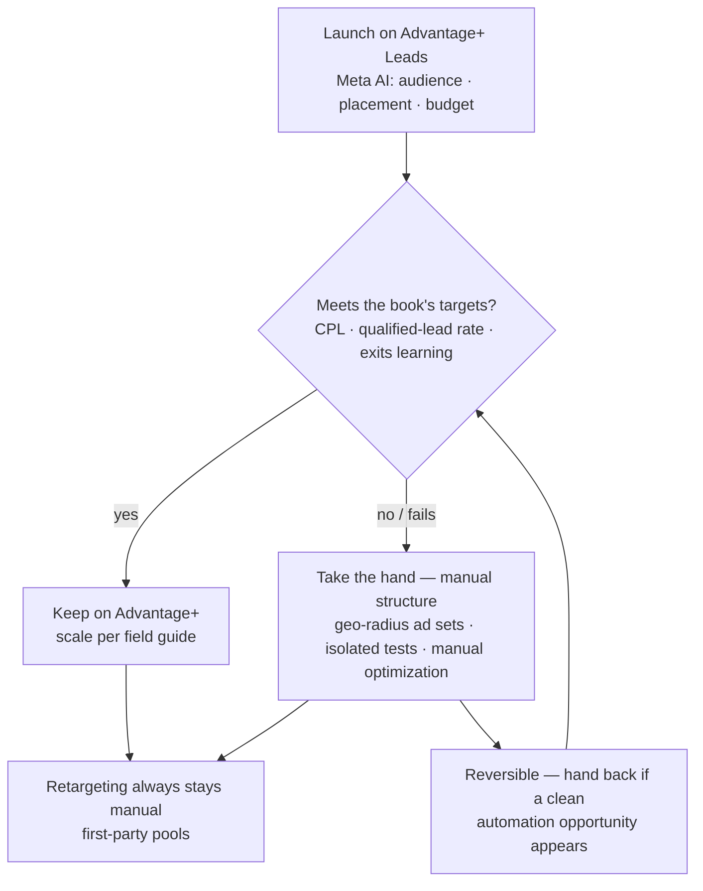
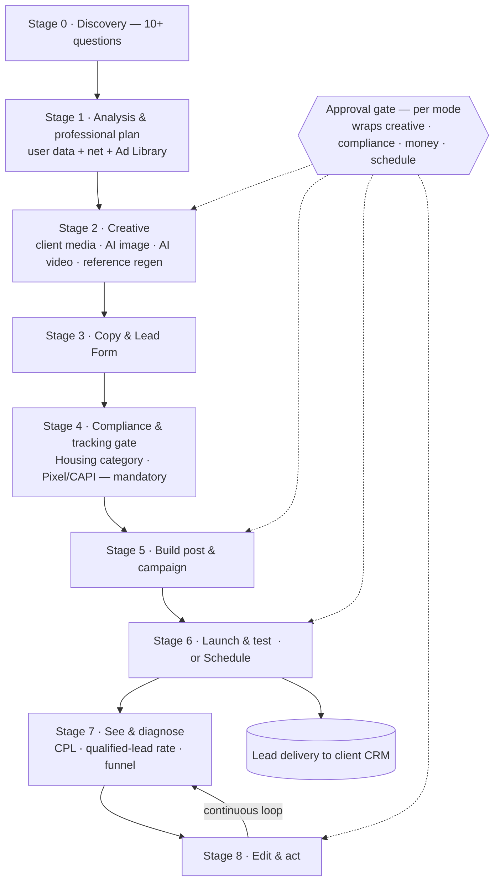
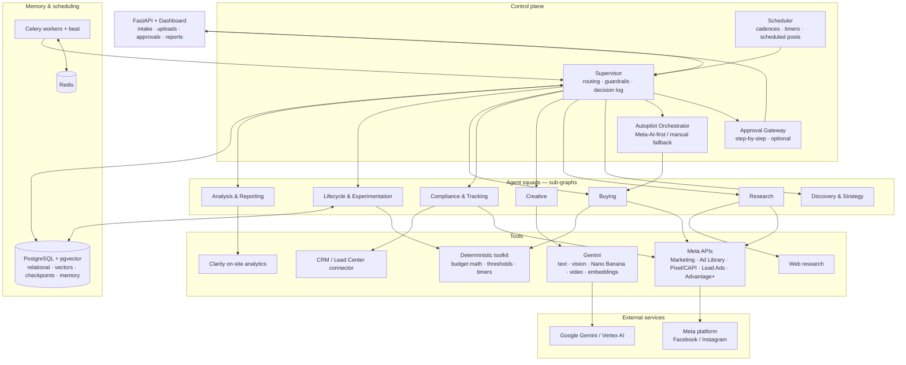

# Autonomous Media Buyer for Real Estate

### Professional Multi‑Agent Project Plan (LangGraph / LangChain)

*A multi‑agent system that runs Meta (Facebook/Instagram) lead‑generation advertising for real‑estate businesses end‑to‑end — discovery, strategy, creative, compliance, launch, testing, optimization, and lead delivery — trying Meta's own AI first and taking manual control when it underperforms, with the user able to approve every step and switch any capability on or off.*

**Author role:** Senior Technical Lead
**Vertical:** Real estate (developers, brokerages, individual agents) — lead generation, not e‑commerce
**Policy engine:** *The Performance Marketer's Field Guide* (the media‑buying playbook this system automates)
**Platform facts are current as of mid‑2026** and change often; compliance and model details live in configuration, not code.

---

## How to read this

This document is the complete professional project plan for the real‑estate version of the system — both the product (what it does, how it decides, why it can stand in for a media buyer) and the production engineering (architecture, memory, database, scaling, security, cost, and rollout). It concentrates on what makes *this* product real: the real‑estate rules that reshape the whole architecture, the agent roster that covers the entire field guide, the "Meta‑AI‑first, take‑the‑hand‑if‑it‑fails" control model, step‑by‑step optional approval, and a production deployment on AWS. There is no source code here.

## Contents

1. Scope & design stance
2. Real‑estate context that reshapes the architecture
3. Operating modes & step‑by‑step approval (everything optional)
4. Meta‑AI‑first, manual‑fallback control model
5. End‑to‑end workflow (discovery → plan → creative → compliance → launch → test → see → edit → act)
6. Architecture overview
7. Agent architecture (full roster, mapped to the field guide)
8. Tools & integrations
9. Conversation summarization & memory management
10. Database design (PostgreSQL)
11. Background processing & scheduling
12. Data & policy (the book as the policy engine)
13. Expected user load & capacity planning
14. Technology stack & AWS
15. Observability & reliability
16. Security & multi‑tenancy
17. Cost model
18. Project folder structure
19. Rollout plan & risks
- Appendix A — Discovery question bank (10+)
- Appendix B — Daily decision logic (lead‑gen)
- Appendix C — Housing compliance checklist
- Appendix D — Optionality matrix
- Appendix E — Agent‑to‑field‑guide coverage map

---

# 1. Scope & design stance

The system performs the full job of a real‑estate media buyer: it interviews the client, researches the market and competitors, builds a professional plan, produces (or accepts) creative, enforces Meta's housing rules, launches and tests lead campaigns, reads the results, proposes and makes edits, manages the daily continue/scale/pause/restart/reschedule decisions, schedules posts and campaigns, and delivers the leads it generates to the client's systems — all while asking for the client's approval at any step the client chooses, and letting the client turn any capability on or off.

Five stances govern the design:

1. **Real estate first.** This is lead generation under Meta's Housing rules, not product sales. The funnel, the metrics, the targeting, and the compliance are all built for that and differ fundamentally from an e‑commerce build (Section 2).
2. **The book is the policy engine.** Every rule, threshold, and decision from the field guide is encoded as a deterministic guardrail or retrievable knowledge; the agents execute a named discipline rather than improvising.
3. **Meta's AI first, the agents second.** The system launches on Meta's own automation (Advantage+ Leads) and only "takes the hand" with the manual, book‑tested method when the automation underperforms or fails (Section 4).
4. **The user is always in the loop, as much or as little as they want.** Approval can be required at every step, only at key/irreversible steps, or only above a spend threshold — the client's choice (Section 3).
5. **Everything is optional.** Creative generation, video, scheduling, retargeting, even full autonomy are capabilities the client switches on or off per their needs (Appendix D).

---

# 2. Real‑estate context that reshapes the architecture

Real estate is not a generic advertiser. Three facts change the entire system, and the agents are built around them.

## 2.1 Housing is a Special Ad Category — targeting is restructured, not free

Meta classifies housing/real‑estate ads under the **Housing Special Ad Category**, and in 2026 it **auto‑detects** the category from the *imagery* itself (building exteriors, floor plans, "for sale" signs) — applying the restrictions even if the advertiser didn't select them, and flagging attempts to evade as an account‑health violation. Under this category:

- **No targeting by age, gender, ZIP/postal code, income, or detailed interests/behaviors,** and audience exclusions are removed. Age is locked to 18–65+ and all genders must be included.
- **Location is the main lever, with a minimum radius** (around 15 miles / 25 km in the US, ~10 miles / 17 km in parts of Europe; rules vary by market). City, region, and country targeting work; neighborhood‑level ZIP targeting does not.
- **Lookalike / "Special Ad Audience" tooling is restricted or deprecated** for housing, so prospecting leans on broad delivery plus first‑party retargeting.
- **The creative does the targeting.** Because demographic levers are gone, message‑matched copy and visuals are what make the right people self‑select. This aligns exactly with the field guide's principle that creative and location — not interest stacking — are the real targeting levers.
- **Copy must be fair‑housing compliant:** no language implying a preferred buyer/tenant type ("perfect for families," "ideal for professionals"), no personal‑attribute "you" framing, and an equal‑opportunity posture.

**Architectural consequence:** a dedicated **Compliance / Special Ad Category agent** sits in the critical path before any launch, the **Audience agent** is rebuilt around geo‑radius and creative‑as‑filter (never demographics), and the **Copy** and **Creative** agents carry fair‑housing validators. The system's safe default is to always produce compliant, category‑declared campaigns regardless of market, because Meta's detection is global and unforgiving.

## 2.2 The funnel is lead generation, and the metrics are different

Real estate sells high‑ticket, long‑cycle products, so the objective is **Leads**, not Purchase. The funnel is: impression → **lead** (Instant Form or website form) → **qualified lead** → **viewing/appointment** → **deal**. Consequently:

- The north‑star metrics are **cost per lead (CPL)**, **cost per qualified lead**, **cost per appointment**, and ultimately **cost per closed deal / commission return** — not ROAS. The field guide's diagnosis and decision logic are re‑expressed in these terms.
- **Instant Forms** (native, in‑platform, pre‑filled) give higher volume and lower CPL but lower intent; **website forms** give higher intent at higher CPL. The system can run either or both in one campaign, choosing based on the client's sales cycle and qualification needs.
- **Lead quality beats lead volume.** Qualifying questions (budget, timeline, area, buyer type), verification (phone/email), and CRM feedback close the loop so the system optimizes toward *qualified* leads, not raw form fills.
- **Speed‑to‑lead is decisive.** A real‑estate lead goes cold in minutes, so the system delivers every lead to the client's CRM or Lead Center in real time, so the client can follow up while it is hot. (Follow‑up and nurture are performed by the client's own systems; the platform's job is fast, reliable delivery.)

## 2.3 Creative is visual‑first and video‑led

Buyers judge property on visuals before price. Video outperforms static; the winning format is a **vertical (9:16) cinematic walkthrough that opens on the most striking feature in the first half‑second** — which is the field guide's hook rule applied to property. Carousels showcase listings and floor plans. The Creative squad is therefore built to produce and judge both **images** (Nano Banana) and **video** (walkthroughs/reels), and to do so in a way that passes the housing visual‑detection and quality bars.

---

# 3. Operating modes & step‑by‑step approval (everything optional)

The client decides how much the system does on its own. Approval is configurable per phase, and every capability is a switch.

## 3.1 Three approval modes

| Mode | The system asks for approval at… | Best for |
|---|---|---|
| **Full Manual** | every step — the plan, each creative, the compliance check, the form, the launch, every budget change, every pause/scale/restart, every schedule | new clients, first campaigns, cautious operators |
| **Guided (default)** | the strategic plan, the final creatives, and all irreversible or money‑moving steps (launch, scale, restart, schedule); routine reads and diagnoses run on their own | most clients once trust is established |
| **Auto‑Pilot** | only spend changes above a configured threshold, and new launches | proven clients with a track record |

The mode can differ per client and can be raised or lowered at any time. This is the same trust progression you'd give a new hire — and it is enforced by the **Approval Gateway** (Section 7), which pauses the workflow and surfaces the pending item for a one‑tap decision.

## 3.2 Every capability is optional

The client turns features on or off to fit their needs: AI image generation, AI video generation, organic posting, post/campaign scheduling, Advantage+ auto‑pilot, the manual fallback, retargeting, lead delivery to CRM, on‑site heatmap analysis, and the secondary Google Ads channel. A broker who only wants compliant campaigns built and managed can disable creative generation; a developer launching an off‑plan project can enable everything. The optionality matrix is in Appendix D.

## 3.3 The system challenges bad inputs

When the client asks for something unhelpful, non‑compliant, or counter to the field guide, the system **says so and proposes a better alternative** rather than complying silently. Examples it catches and redirects: asking to target a single ZIP or an age band (not allowed under Housing — it suggests radius + creative‑as‑filter instead); copy like "perfect for families" (fair‑housing violation — it rewrites neutrally); a $3/day test budget (below the floor to exit learning — it suggests the minimum that will actually test); launching on a Friday or discounting in peak season (against the playbook — it suggests timing alternatives); or thirty tiny campaigns instead of one consolidated lead campaign (fragments the AI's signal — it suggests consolidation). Each flag comes with the reason and a recommended fix.

---

# 4. Meta‑AI‑first, manual‑fallback control model

This is the "use auto with Meta AI, but take the hand if it fails" requirement, formalized into a control loop owned by the **Autopilot Orchestrator** agent. It mirrors the recommended 2026 practice of testing Meta's automation against the manual method and keeping whichever wins, with manual retained for retargeting.

## 4.1 The loop

1. **Launch on Meta's AI by default.** New lead campaigns start as **Advantage+ Leads**, where Meta's AI runs audience, placements, and budget. The Compliance agent guarantees the Housing category is declared and the creative and form are compliant before launch.
2. **Evaluate against the book's guardrails.** Over a defined window (aligned to the learning phase — roughly 50 conversions per week — or a multi‑week A+‑versus‑manual comparison), the system measures Advantage+ against the lead‑gen targets: CPL, qualified‑lead rate, learning‑phase exit, frequency, and creative fatigue.
3. **Keep, or take the hand.**
   - If Advantage+ **meets or beats** the targets and exits learning, the system keeps it on auto and continues scaling per the field guide.
   - If Advantage+ **fails** — it can't exit learning, CPL is too high, qualified‑lead rate is poor, frequency runs away, or a policy problem appears — the system **takes manual control**: it disables the automation and rebuilds the campaign with the manual, book‑tested structure (geo‑radius ad sets, isolated‑variable testing, the manual optimization loop), because that is where the system's encoded expertise has the most leverage.
   - **Retargeting always stays manual**, using the first‑party pools, where audience precision (not Meta's broad AI) is the point.
4. **Stay reversible.** If a manual campaign later proves a clean automation opportunity, the system can hand back to Advantage+. The choice is data‑driven and logged, and — depending on mode — gated by the client's approval.



## 4.2 Why this is the right default

Meta's automation is genuinely strong when there is enough conversion volume for it to learn, and real estate at reasonable budget often reaches that. Starting on Advantage+ captures that upside cheaply; falling back to the manual method protects the campaigns that automation handles badly (thin volume, niche locations, quality over quantity). The system gets the best of both because it can *measure* which is winning and *switch*, which a human rarely does rigorously.

---

# 5. End‑to‑end workflow

The system moves through nine stages. Each stage that touches creative, compliance, money, or scheduling has an approval gate that is active or silent depending on the client's mode. The "make a post and a campaign, test it, see, edit, and act after approval" requirement is the spine of stages 5–9.



## 5.1 Stage 0 — Discovery (the 10+ question interview)

The **Discovery agent** runs a structured, adaptive interview of at least a dozen questions to learn everything needed for a professional plan (full bank in Appendix A): who the advertiser is (developer, brokerage, or agent), the property type (apartment, villa, townhouse, commercial, land) and status (off‑plan or ready), the location and catchment, the price range and payment plans, the unique selling points and amenities, the target buyer (investor, end‑user, first‑home), the goal (leads, calls, viewings, brand), the ad budget and timeline, the existing assets (page, pixel, CRM, photos, videos, any license/registration), the competitors, and any past results. It adapts: thin or risky answers trigger follow‑ups, and it challenges anything unhelpful or non‑compliant on the spot (Section 3.3).

## 5.2 Stage 1 — Analysis & professional plan

The **Market & Data Analysis agent** combines the client's answers with live research from the net and the Meta Ad Library to produce a professional plan: the recommended objective (Leads) and conversion location (Instant Form, website, or both), the geo‑radius targeting strategy, the funnel and offer angle, the creative direction, the budget and test structure, the KPIs and targets (CPL, qualified‑lead rate), and the launch timing. The plan is presented for approval and revised on feedback. This stage analyzes data "from the user and the net" exactly as required, and the output is a concrete, defensible strategy rather than a generic template.

## 5.3 Stage 2 — Creative (with or without generated media)

Creative is optional and supports four paths, chosen per the client's needs:

- **Client‑supplied media.** The client uploads their own property photos or video; the system uses them as‑is (after a quality and compliance check).
- **AI‑generated images.** The **Image Generation agent** (Nano Banana) creates or retouches property creatives — background, lighting, single‑keyword overlay, brand framing — producing the variety the algorithm rewards.
- **AI‑generated video.** The **Video Generation agent** produces vertical cinematic walkthroughs/reels that open on the strongest feature (the hook rule).
- **Reference‑based regeneration.** When the client wants a specific look, they **provide a screenshot of a post they like (for theme and typography) or a description of it**; the **Style Reference Extraction** step reads the palette, typography, layout, and mood from the reference, and the Image/Video agent regenerates the property creative in that style. This is how a client "invokes the theme and the type of typography" without writing a brief.

Every creative passes the **Creative Analysis & compliance pre‑check** (hook strength, single legible keyword, clear audio for video, and awareness that housing imagery triggers Meta's auto‑detection) before it can be used, then goes to the client for approval.

## 5.4 Stage 3 — Copy & form

The **Copy agent** writes fair‑housing‑compliant ad copy on the AIDA spine — strong hook, explicit call to action, social proof, neutral language, equal‑opportunity posture, no hashtags in paid, minimal emojis. The **Lead Form agent** builds the Instant Form: form type (More Volume for reach, Higher Intent for qualification), the qualifying questions that matter in real estate (budget, timeline, area, buyer type), the intro and thank‑you screens, the privacy policy, and verification (phone/email) to suppress junk leads. Copy and form are presented for approval.

## 5.5 Stage 4 — Compliance & tracking gate

Before anything spends, the **Compliance / Special Ad Category agent** verifies the Housing category is declared, the targeting obeys the restrictions (geo‑radius, no demographics, no ZIP), and the copy and visuals pass fair‑housing checks — preventing the rejections and "evasion" flags that damage account health. In parallel, the **Pixel & Events agent** confirms the pixel and Conversions API are live and that the lead events (Lead, Contact, CompleteRegistration) fire and deduplicate, surfacing Event Match Quality issues. This gate is mandatory regardless of mode.

## 5.6 Stage 5 — Build the post and the campaign

The **Buying squad** assembles the campaign: objective, Advantage+ Leads (default) or the manual structure, the geo‑radius ad sets, the test budget above the floor, the bid strategy, and the approved creative, copy, and form. It can also prepare an **organic post** of the same creative if the client wants one. The full build is presented for launch approval.

## 5.7 Stage 6 — Launch & test

On approval, the system launches at a **test budget** and enters the testing discipline: one variable isolated per test, a minimum run before judging, learning‑phase respected. If the client asked to **schedule** the launch for a particular time (or a recurring post/campaign), the **Scheduler** holds it and fires at the chosen window, honoring the timing rules (start the week clean, avoid Friday launches, daypart where useful).

## 5.8 Stage 7 — See & diagnose

Every six hours the **Optimization agent** pulls metrics; daily, after attribution settles, the **Lifecycle agent** runs the lead‑gen diagnosis (CPL, qualified‑lead rate, funnel drop‑off from impression to form to qualified lead, frequency, the delivery rankings, video‑hook rate). It also evaluates the Advantage‑versus‑manual question (Section 4). The client sees a clear read of what's working and what isn't.

## 5.9 Stage 8 — Edit & act (after approval)

Based on the diagnosis, the system **proposes edits and actions** — continue, scale, reduce, pause, restart cleanly, reschedule, refresh fatigued creative, tighten the form, switch conversion location, or take the hand from Advantage+ — each with its rationale. In Full Manual mode every action waits for approval; in Guided mode the irreversible ones do; in Auto‑Pilot mode only spend above the threshold does. Approved actions are executed via the Meta API and logged. Then the loop returns to Stage 7. This realizes the "test → see → edit → take action after approval" cycle the client asked for, continuously and within guardrails.

## 5.10 Lead delivery

As leads arrive, the **Lead Form agent** reads each submission and the CRM connector delivers it to the client's CRM or Lead Center in real time, so the client can follow up while the lead is hot. Qualified‑lead and deal outcomes the client sends back flow in as offline conversions, closing the optimization loop on *quality*, not just volume. Lead follow‑up, scoring, and nurture are performed by the client's own systems; the platform owns generation, delivery, and the quality feedback signal.

---

# 6. Architecture overview

The platform is layered, each layer with one responsibility. A thin interface layer handles the human touchpoints; a LangGraph orchestration layer runs the agents; a tool layer reaches external services; and a memory and scheduling layer sits on PostgreSQL and Redis. On AWS this maps to ECS Fargate services behind a load balancer, RDS PostgreSQL with pgvector, ElastiCache Redis, and S3, with all model calls egressing to Google's Gemini API.

| Layer | Responsibility |
|---|---|
| **Interface (FastAPI + dashboard)** | The discovery interview, media uploads, the approval queue, live status, and reports — the two human touchpoints and full visibility |
| **Orchestration (Supervisor)** | A LangGraph router that inspects the shared state, decides which squad runs next, enforces the housing and account‑health guardrails before any Meta write, opens approval interrupts when money is at stake, and writes the decision log |
| **Squads (sub‑graphs)** | Discovery, Research, Creative, Compliance & Tracking, Buying, Lifecycle & Experimentation, and Analysis — each a self‑contained, independently testable sub‑graph |
| **Tools** | Meta Marketing API, Ad Library API, Pixel/CAPI, Lead Ads, Advantage+ controls, Gemini text/vision/image/video, web research, CRM delivery, on‑site analytics, and the deterministic toolkit |
| **Memory & scheduling** | PostgreSQL (relational hierarchy, time‑series metrics, decisions, policies), pgvector (the field guide, research corpus, prior‑campaign vectors, and conversation memory), and Celery/Redis driving the cadences and timer sweeps |



The orchestration is a **supervisor graph with squad sub‑graphs**. The supervisor is a router, not a worker: it reads the shared campaign state and routes by phase and live condition (for example, "this ad set is still in the learning phase → hold, skip optimization"), pausing at the Approval Gateway whenever the client's mode requires a decision. The shared state — client and property profile, offer, audience, research, creatives and copy, the campaign plan, live ad‑set snapshots and learning state, the latest diagnosis, decisions, the current phase, any pending approval, and the rolling conversation summary — is checkpointed to PostgreSQL, so a scheduled job that wakes six hours later resumes the exact state rather than rebuilding it. This durability is what lets a campaign live for weeks under autonomous management.

Two design rules run through every layer. **Money logic is deterministic** — budgets, thresholds, the learning‑phase check, the scaling calculation, overlap detection, and timer logic are computed in code, never by a model — while **AI is reserved for judgment**: discovery, copy, research synthesis, vision, summarization, and ambiguous diagnosis. And **autonomy is bounded**: irreversible or high‑cost actions pass through approval gates and hard spend caps, so the system is aggressive about analysis and conservative about spend.

---

# 7. Agent architecture (full roster, mapped to the field guide)

The system is a LangGraph supervisor graph with squad sub‑graphs. The roster below is deliberately complete so that **everything in the field guide is owned by an agent**, plus the real‑estate and control requirements. Each agent notes the field‑guide chapters it encodes; the full coverage map is Appendix E.

## 7.1 Control plane

- **Supervisor** — routes the graph by phase and state, enforces guardrails before any Meta write, and writes the decision log. Deterministic routing; AI only for ambiguous cases.
- **Approval Gateway** — pauses the workflow at each configured gate and surfaces the pending item for the client's decision (Section 3). Implements step‑by‑step optional approval.
- **Autopilot Orchestrator** — owns the Meta‑AI‑first, manual‑fallback control loop (Section 4).
- **Scheduler** — fires the cadences (6‑hour optimization, daily diagnosis, ~15‑minute timer sweeps) and the client's scheduled posts/campaigns, honoring the timing rules.

## 7.2 Discovery & Strategy squad

- **Discovery agent** — the 10+ question interview; challenges weak/non‑compliant inputs (field guide Ch 22 steps 1–3).
- **Market & Data Analysis agent** — synthesizes user data + net + Ad Library into the professional plan (Ch 9–11, 20).
- **Offer/Listing agent** — structures the property offer (off‑plan vs ready, payment plans, USPs, trust signals) that feeds creative and copy (Ch 2, 22).

## 7.3 Research squad

- **Audience agent** — housing‑compliant targeting: geo‑radius, broad delivery, creative‑as‑filter, and first‑party retargeting pools; never demographics or ZIP (Ch 5, 13, 17, reshaped by §2.1).
- **Competitor agent** — mines the **Meta Ad Library API** for currently‑running competitor housing ads, extracting proven hooks, offers, and formats; run‑length as the winner signal (Ch 20).
- **Trend & Demand agent** — market seasonality and demand windows (paydays, launch seasons) feeding scheduling and reschedule decisions (Ch 15 timing).

## 7.4 Creative squad

- **Creative Direction agent** — concept and angle on the AIDA spine, property‑led (Ch 2, 12).
- **Copy agent** — fair‑housing‑compliant AIDA copy, CTA, social proof; validators block hashtags, excessive emojis, and preference language (Ch 6, 22, §2.1).
- **Image Generation agent (Nano Banana)** — generate/retouch property images; reference‑based style regeneration from a screenshot or description (Ch 5).
- **Video Generation agent** — vertical cinematic walkthroughs/reels with a strong opening hook (Ch 14 video‑hook).
- **Style Reference Extraction** — reads theme, typography, layout, and mood from a client's reference screenshot to drive regeneration (new capability).
- **Creative Analysis & compliance pre‑check agent** — vision QC: hook strength, single legible keyword, audio clarity, and housing‑imagery awareness; gates weak or risky creative (Ch 5, 14).
- **Hashtag agent (organic only)** — hashtags for organic posts; blocked from paid creatives (Ch 6).

## 7.5 Compliance & Tracking squad (real‑estate critical)

- **Compliance / Special Ad Category agent** — declares the Housing category, enforces the targeting restrictions and fair‑housing copy/visual rules per market, and prevents evasion flags (§2.1; Ch 6 account health; ad‑rejection handling).
- **Pixel & Events agent** — sets up and verifies the **Meta Pixel** and Conversions API, the lead events (Lead, Contact, CompleteRegistration), event deduplication, Event Match Quality, and offline conversions for qualified leads and deals (Ch 8, 18).
- **Lead Form agent** — builds Instant Forms (More Volume vs Higher Intent), qualifying questions, and verification; reads submissions and hands them to the CRM connector for real‑time delivery (§2.2).

## 7.6 Buying squad

- **Campaign Architect / Budget agent** — Leads objective; Advantage+ or manual structure; geo‑radius ad sets; CBO/ABO; test‑budget floors; the deterministic budget and scaling math (Ch 7, 10, 11, 15).
- **Bid agent** — bid strategy and cost controls aligned to target CPL (Ch 1, 8).
- **Optimization agent (6h)** — pulls metrics, computes the lead‑gen ratios, flags anomalies; never acts during learning (Ch 14, 16).

## 7.7 Lifecycle & Experimentation squad

- **Lifecycle / Decision agent** — the daily continue/scale/reduce/pause/restart/reschedule decision in lead‑gen terms, and the Advantage‑vs‑manual call; never stops‑and‑restarts a winner (Ch 14–16; Appendix B).
- **Testing / Experiment agent** — runs the isolated‑variable testing method (budget, creative, location), minimum durations, the Fix → Test → Analyze → Scale loop (Ch 9–13).
- **Retargeting agent** — the three retargeting cases from first‑party pools (form openers who didn't submit, video viewers, past leads), kept manual for precision (Ch 17).

## 7.8 Analysis & Reporting squad

- **Reporting agent** — daily reports in lead‑gen language (CPL, qualified‑lead rate, funnel, decisions taken and why), with the benchmark caveat (Ch 14).
- **Insights agent** — deep analysis: the three delivery rankings, retargeting‑pool growth, creative‑fatigue calls, strategic recommendations (Ch 14, 17).
- **Landing / Funnel Analysis agent** — for website‑form campaigns, on‑site heatmap and funnel analysis (Clarity) to localize friction; for Instant Forms, drop‑off analysis by field (Ch 19).

---

# 8. Tools & integrations

Tools are the capabilities agents call. Deterministic tools (budget math, threshold checks, learning‑phase and timer logic, overlap detection) never use a model; integration tools wrap external services. The set:

| Tool group | Purpose |
|---|---|
| **Meta Marketing API** | Create and manage campaigns, ad sets, ads; set budgets, bids, schedules; read insights |
| **Meta Ad Library API** | Research currently‑running competitor housing ads (hooks, offers, formats, run‑length) |
| **Meta Pixel + Conversions API** | Server‑and‑browser tracking of lead events with deduplication and Event Match Quality; offline conversions for deals |
| **Meta Lead Ads / Instant Forms** | Build and read native lead forms; deliver submissions in real time |
| **Advantage+ controls** | Enable/disable Meta's AI automation for the auto‑first / fallback loop |
| **Gemini (text)** | Discovery, copy, research synthesis, rationale, summarization |
| **Gemini (vision)** | Product/creative analysis, style‑reference extraction, housing‑imagery awareness |
| **Nano Banana (image)** | Generate and edit property creatives, including reference‑based regeneration |
| **Video generation** | Cinematic vertical walkthroughs/reels |
| **Web research** | Market, demand, and trend research from the net |
| **CRM / Lead Center connector** | Real‑time delivery of leads to the client's CRM, and intake of qualified‑lead/deal status as offline conversions |
| **On‑site analytics (Clarity)** | Heatmaps and funnel analysis for website‑form campaigns |
| **Deterministic toolkit** | Budget and scaling math, thresholds, learning/attribution checks, timers, overlap detection — all non‑AI |

---

# 9. Conversation summarization & memory management

The system has two memory layers, and it summarizes each conversation when it ends so the client's knowledge compounds the way a real‑estate buyer's experience would.

**Short‑term memory (within a thread)** is the per‑campaign graph state plus a rolling summary, persisted by the checkpointer. The full transcript is never re‑sent once summarized, so cost and latency stay flat even across a long discovery or a weeks‑long campaign.

**Long‑term memory (across sessions)** is durable client knowledge held in a vector‑indexed store in the same PostgreSQL: what this client sells, their areas and price bands, the offers and creative that have worked, their compliance constraints, and the outcomes of past campaigns — namespaced per client so nothing bleeds across tenants.

**Summarization fires on two triggers**, both handled by a dedicated summarizer running on a cheap model. First, **on conversation end** — when the discovery interview or any chat thread is marked complete (or after an idle timeout), the summarizer condenses it into a *structured* summary: client and property context, decisions and their rationale, outcomes, open questions or pending approvals, and durable preferences. That summary is **merged** into the client's long‑term memory (not blindly appended) and embedded for semantic recall. Second, **on context pressure** — when a long thread crosses a token threshold, older messages are folded into the rolling summary and dropped from the active window.

**How memory is used next time:** at the start of any new thread for a client, the relevant long‑term memories are retrieved (semantic plus recency) and injected into context, so the agents begin already knowing the client and can draw on the closest prior situations when they decide. A cheap model and a structured schema are deliberate: summarization is high‑frequency and low‑judgment, so it stays nearly free at scale, and structured output makes merging deterministic and prevents the drift that free‑text summaries accumulate over many sessions. This is the mechanism behind the system's accumulating edge — it remembers every property, market, and outcome instead of starting cold.

---

# 10. Database design (PostgreSQL)

## 10.1 One database, four responsibilities

A single PostgreSQL instance (RDS or Aurora) serves four roles, which simplifies operations and lets one transaction touch related data:

1. **Relational state** — the Meta hierarchy (clients, properties, offers, campaigns, ad sets, ads, creatives, copy), time‑series metric snapshots, decisions, and the tunable policy store.
2. **Vector store (pgvector)** — the embedded field guide, the competitor/research corpus, and prior‑campaign vectors for retrieval.
3. **Graph checkpoints** — LangGraph's thread‑scoped campaign state.
4. **Long‑term memory** — cross‑session client knowledge and conversation summaries.

## 10.2 Connection pooling — done right

A known failure mode is recreating the connection pool on every request, which exhausts the database. The design uses **one shared async pool** created at process startup, and on AWS fronts the database with **RDS Proxy** to multiplex connections, absorb worker spikes, and survive failovers. Pool size is bounded to the database's connection ceiling — roughly the number of worker processes times their per‑process concurrency, kept under the maximum with headroom.

## 10.3 Time‑series metrics at scale

Metric snapshots (written every six hours per ad set) are the highest‑churn data. They are **append‑only and partitioned by month**, so trend queries scan only relevant partitions and expired partitions are pruned cheaply. Recent data is kept at six‑hour granularity; older data is downsampled to daily aggregates by the nightly job. Reports read from **materialized views** refreshed nightly, not from raw rows.

## 10.4 Retrieval

Retrieval is hybrid — dense pgvector similarity fused with sparse full‑text — with optional reranking on the top candidates, serving three needs: book rules, prior‑campaign analogues, and competitor intelligence for the niche. Indexes are refreshed on schedule and recall is monitored.

## 10.5 Multi‑tenancy

Every tenant‑scoped table carries a client identifier, and **row‑level security** enforces isolation at the database, so a query can never read across tenants even on a code bug. Vector namespaces are likewise per tenant. Lead records carry only what is needed for delivery and the quality feedback signal, with personal fields stored hashed where used for match quality.

---

# 11. Background processing & scheduling

## 11.1 What runs in the background

| Job | Cadence | Notes |
|---|---|---|
| Metrics optimization | every 6h | Meta read + snapshot write; AI only on anomalies |
| Daily diagnosis | once/day after attribution settles | the Lifecycle decision per ad set |
| Timer sweep | every ~15 min | launches due? scheduled increases? reschedules? client‑scheduled posts? |
| Weekly scale review | weekly | next scheduled increase + readiness to absorb more leads |
| Research refresh | daily/weekly per niche | competitor and demand research |
| Conversation summarization | on end / threshold | structured summaries to long‑term memory |
| Data cleanup | nightly | dedup, retention, embedding refresh, reconciliation |

## 11.2 Celery, Redis, and the scheduler

Workers consume tasks from Redis; the API enqueues. The one subtlety is the scheduler: running multiple Celery **beat** replicas double‑fires jobs. The plan runs beat as a **single‑replica service** (or replaces it with **Amazon EventBridge Scheduler** invoking the task endpoints), so schedules — including the client's scheduled posts and campaigns — fire exactly once. Worker services **autoscale on queue depth**.

## 11.3 Idempotency and burst flattening

Every scheduled action carries an **idempotency key** (campaign + window) so a retried task never double‑applies a budget change or relaunches a post twice. The daily diagnosis and 6‑hour optimization are naturally **synchronized bursts** across all tenants; left alone they spike model usage and trigger rate‑limit errors, so the scheduler **staggers** them across a window with per‑tenant jitter to flatten the call rate (Section 13).

---

# 12. Data & policy (the book as the policy engine)

The field guide is ingested as the system's knowledge base: chunked, embedded, and retrieved before judgment calls, so agents reason from the playbook. The *numeric* rules — budget floors, learning‑phase thresholds, frequency ceilings, the scaling percentage, attribution windows, spend caps — live in a typed policy store and are read deterministically, re‑expressed for lead generation (CPL targets, qualified‑lead rates) rather than ROAS. The **housing compliance rules** live in their own policy set, keyed by market, so the Compliance agent applies the right radius and restrictions per region.

Data spans the Meta hierarchy mirrored locally, six‑hourly metric snapshots, the competitor and research corpus, the lead delivery and quality‑feedback records, and the decision‑and‑outcome log that compounds into the system's edge. All of it is tenant‑isolated.

---

# 13. Expected user load & capacity planning

Capacity is governed by **Gemini quota (requests and tokens per minute)**, not server compute — the agents are I/O‑bound on model and Meta API calls.

## 13.1 Load model

A single real‑estate client (a developer, brokerage, or agent) generates a predictable daily workload across its active property/listing campaigns: 6‑hour optimization (mostly deterministic, with AI only on anomalies), a daily diagnosis per ad set, frequent timer sweeps (near‑zero AI), the occasional new campaign build (discovery + research + copy + a few creatives), a daily report, periodic research refresh, and conversation summaries — most of which run on the cheap model tier and can be batched.

## 13.2 Three capacity tiers

| | Pilot | Growth | Scale |
|---|---|---|---|
| Clients | ~50 | ~500 | ~5,000 |
| Active campaigns | ~100 | ~1,000 | ~10,000 |
| Ad sets | ~300 | ~3,000 | ~30,000 |
| AI text calls/day | ~500 | ~5,000 | ~50,000 |
| Avg sustained rate | <1/min | ~3–4/min | ~35/min |
| Burst (daily window) | tens/min | ~50–100/min | hundreds/min |
| Gemini tier | Tier 1 | Tier 2 | Tier 3 (negotiated) |
| Per‑client model cost | low single‑digit $/mo | low single‑digit $/mo | low single‑digit $/mo |

The headline: **per‑client model cost stays in the low single‑digit dollars per month** — a fraction of a real‑estate buyer's or agency's fee — because most volume runs on the cheap tier with batching and caching. The real risk is the **synchronized daily burst**, not the average rate.

## 13.3 Mitigations

The binding wall is requests‑per‑minute, so the system **staggers** the daily diagnosis across a window with per‑tenant jitter, runs non‑real‑time work (reports, summaries, research) through the **batch path** off the synchronous quota, **caches** the repeated field‑guide and per‑client prompts, and keeps the strongest (most quota‑constrained) model for the rare ambiguous decision. Very large deployments can **shard tenants across separate Gemini projects** to multiply effective quota. Meta's own API limits are handled by batched 6‑hour pulls with backoff. Compute scales cheaply because the agents are I/O‑bound on remote calls.

---

# 14. Technology stack & AWS

The stack is LangGraph and LangChain native, FastAPI, PostgreSQL with pgvector (relational state, vectors, checkpoints, long‑term memory), Celery with Redis for cadences and scheduling, and Google Gemini for reasoning, vision, image (Nano Banana), and video, with embeddings for retrieval. Models are selected per agent — a cheap tier for high‑frequency work (routing, summarization, reporting, hashtags), a workhorse tier for the value work (discovery, copy, vision, synthesis), and a reasoning tier reserved for ambiguous diagnosis — with model identifiers held in configuration so they can be swapped without redeploying code, which matters because Gemini deprecates quickly.

| Layer | Technology | Notes |
|---|---|---|
| Orchestration | LangGraph | Supervisor + sub‑graphs, checkpointing, interrupts |
| Agent framework | LangChain | Tools, structured output, retrievers — kept thin |
| Models | Google Gemini (text, vision, Nano Banana image, video) + embeddings | Tiered by role; IDs in config |
| Backend API | FastAPI (async) | Intake, uploads, approvals, reports |
| Database | RDS / Aurora PostgreSQL (Multi‑AZ) + pgvector | Relational, vectors, checkpoints, memory |
| Pooling | RDS Proxy | Solves connection storms and failover |
| Cache & broker | ElastiCache for Redis | Celery broker + app cache |
| Compute | ECS Fargate | API, workers, beat as separate services |
| Storage | S3 (+ CloudFront) | Creatives, videos, reports, uploads |
| Secrets & config | Secrets Manager + SSM Parameter Store | Tokens (rotated); model IDs, policy, compliance rules, feature flags |
| Scheduling | Celery beat (single) or EventBridge Scheduler | Exactly‑once firing |
| Edge | ALB + AWS WAF | TLS, WAF, health checks |
| Observability | CloudWatch + tracing + OpenTelemetry | Metrics, logs, alarms, traces |
| IaC & CI/CD | Terraform; GitHub Actions → ECR → ECS | Reproducible footprint; blue/green deploys |

Because Gemini is a Google service, the AWS workloads call Google's Gemini API (or Vertex AI) over the network — meaning egress through the NAT gateway and cross‑cloud latency to budget for, and a preference for Vertex AI where enterprise data‑residency and no‑training guarantees matter. The model layer is provider‑abstracted so an alternative could be slotted in for fallback.

---

# 15. Observability & reliability

End‑to‑end tracing combines agent‑level traces (every agent run, tool call, token count, latency, and decision rationale) with CloudWatch (infrastructure metrics, structured logs, alarms) and OpenTelemetry spans across the API and workers. Every decision is also written to a decision audit table, so "why did it pause this ad set?" or "why did it take the hand from Advantage+?" is answerable from data, not logs alone.

Key alarms: model rate‑limit errors and spend‑cap proximity; Meta API errors and throttling; **housing‑policy rejections or evasion flags**; CPL and cost‑per‑qualified‑lead breaching danger thresholds; Celery queue depth and task failures; database connection saturation and replica lag; and the **circuit breaker** firing when account spend velocity or cost‑per‑result crosses a danger threshold. The circuit breaker is fail‑safe: it pauses spend and alerts rather than continuing blindly. High availability comes from Multi‑AZ across compute and database, automated backups with point‑in‑time recovery, and state reconciliation against Meta on recovery — a short control‑plane outage is tolerable because Meta keeps delivering, and the system re‑syncs when it returns.

---

# 16. Security & multi‑tenancy

- **Tenant isolation** at three layers: client‑identifier scoping, PostgreSQL row‑level security, and per‑tenant vector namespaces, so no client's data — leads, creatives, or research — can reach another.
- **Credential handling:** Meta, Google, and Gemini credentials are per‑client, scoped, stored in Secrets Manager, and rotated; agents receive capabilities, never long‑lived secrets in state. No payment data is ever entered or stored; the system handles identifiers and tokens only. Lead personal data used for match quality is stored hashed and never logged in plaintext.
- **Data privacy:** production uses paid Gemini or Vertex AI so inputs are not used for model training.
- **Provenance rule:** content fetched from the web or competitor pages is data, never instructions; the system never lets scraped content redirect spend, change targeting, or alter rules. Only the client (via the interface) and the codified policy direct action.
- **Network:** databases and cache live in private subnets; only the load balancer is public; a web application firewall guards the edge; all traffic is encrypted in transit and at rest.

---

# 17. Cost model

Three cost centers: **model inference**, **infrastructure**, and **platform APIs**.

- **Model inference** dominates variable cost but stays low per client (low single‑digit dollars per month) through cheap‑tier routing, batching, and prompt caching, and scales sub‑linearly as caching grows.
- **Infrastructure** (Fargate, RDS or Aurora, ElastiCache, S3, NAT, data transfer) is a modest fixed‑plus‑usage base that grows in steps as the capacity tiers increase; cross‑cloud egress to Gemini is a line item to watch and a reason to consider Vertex AI or private connectivity at scale.
- **Platform APIs** (Meta, Google Ads) are generally free to call within rate limits; the cost there is the engineering to handle their throttling.

The business case is simple: total cost per managed client lands well under the cost of the human labor it replaces — a real‑estate buyer's salary or an agency's retainer plus percentage of spend — and most of it is variable and quota‑shaped rather than fixed.

---

# 18. Project folder structure

A clean monorepo separates the runnable services from the reusable packages, keeps each squad's agents together, isolates tools and policy, and puts infrastructure and configuration outside the code. The book and the compliance rules are first‑class data assets.

```
real-estate-media-buyer/
├── apps/
│   ├── api/                       # FastAPI service: intake, uploads, approvals, dashboards
│   └── workers/                   # Celery workers + beat (cadences, timers, schedules)
│
├── packages/
│   ├── graph/                     # LangGraph orchestration
│   │   ├── supervisor/            # router, guardrail enforcement, decision log
│   │   ├── state/                 # shared campaign state definitions
│   │   ├── checkpoints/           # Postgres checkpointer wiring
│   │   ├── approvals/             # Approval Gateway (step-by-step, optional)
│   │   ├── autopilot/             # Meta-AI-first / manual-fallback control loop
│   │   └── subgraphs/             # one compiled sub-graph per squad
│   │
│   ├── agents/                    # agent definitions, grouped by squad
│   │   ├── discovery/             # Discovery, Market & Data Analysis, Offer/Listing
│   │   ├── research/              # Audience, Competitor, Trend & Demand
│   │   ├── creative/              # Direction, Copy, Image (Nano Banana), Video,
│   │   │                          #   Style-Reference, Creative-Analysis, Hashtag
│   │   ├── compliance/            # Special Ad Category, Pixel & Events, Lead Form
│   │   ├── buying/                # Campaign Architect/Budget, Bid, Optimization
│   │   ├── lifecycle/             # Lifecycle/Decision, Testing/Experiment, Retargeting
│   │   └── analysis/              # Reporting, Insights, Landing/Funnel Analysis
│   │
│   ├── tools/                     # LangChain tools
│   │   ├── meta/                  # marketing_api, ad_library, pixel_capi, lead_ads, advantage_plus
│   │   ├── google_ads/            # secondary channel
│   │   ├── gemini/                # text, vision, nano_banana (image), video
│   │   ├── research/              # web search/fetch
│   │   ├── crm/                   # lead delivery connector (CRM / Lead Center)
│   │   ├── analytics/             # clarity / on-site funnel
│   │   └── deterministic/         # budget math, thresholds, timers, overlap, learning checks
│   │
│   ├── memory/                    # long-term store, conversation summarization, RAG retrieval
│   ├── policy/                    # the book as policy: rules, numeric constants, decision logic
│   ├── compliance/                # housing special-ad-category rules per market
│   ├── models/                    # Gemini model router + per-role config
│   └── schemas/                   # Pydantic domain models (client, property, offer, campaign, lead...)
│
├── knowledge/                     # the field guide + embeddings source (the policy engine)
├── infra/                         # Terraform: VPC, ECS, RDS+pgvector, ElastiCache, S3, secrets
├── config/                        # model-by-role, policy constants, compliance rules, feature flags
├── migrations/                    # database migrations
├── tests/                         # unit (deterministic tools), integration (agents), e2e (workflow)
└── docs/                          # plans, runbooks, onboarding
```

The structure mirrors the architecture: `graph/` holds orchestration including the Approval Gateway and the Autopilot loop; `agents/` is organized by the squads in Section 7; `tools/meta/` carries the Marketing API, Ad Library API, Pixel/CAPI, Lead Ads, and Advantage+ controls; `compliance/` and `config/` keep the housing rules and feature flags out of code so they can change per market and per client; and `knowledge/` holds the field guide that drives the whole policy engine.

---

# 19. Rollout plan & risks

## Phased delivery

1. **Discovery & compliant creative.** Discovery interview, Market & Data Analysis, Copy, Image (Nano Banana) with reference‑based regeneration, the Compliance agent, and the conversation‑summarization memory. Produces a compliant plan and creative with full step‑by‑step approval, no spend.
2. **Launch & manage on Meta AI.** Pixel & Events, Lead Form with CRM delivery, the Buying squad, the Autopilot Orchestrator (Advantage+ first), the Lifecycle loop, and the Scheduler. The system can launch, test, see, edit, and act on lead campaigns within guardrails and approvals.
3. **Manual mastery & depth.** The Testing/Experiment and Retargeting agents, the manual fallback structure, Insights, Landing/Funnel analysis, and video generation.
4. **Scale & learn.** Burst‑aware scheduling, batching and caching, tenant sharding across Gemini projects, the secondary Google Ads channel, and per‑market policy tuning from the accumulating outcome data.

## Risks & mitigations

| Risk | Mitigation |
|---|---|
| Housing‑policy violation or evasion flag | Compliance agent in the critical path; fair‑housing copy/visual validators; category always declared; per‑market rules in config |
| Optimizing for cheap junk leads, not quality | Qualifying questions + verification + quality feedback; optimize toward qualified leads and deals via offline conversions |
| Meta AI underperforms on niche/low‑volume campaigns | Autopilot Orchestrator measures and takes the hand; manual retained for retargeting |
| Acting during learning or on unsettled data | Deterministic guards default to hold |
| Autonomous overspend | Hard caps, spend‑approval gates, circuit breaker; approval mode per client |
| Synchronized bursts trigger rate‑limit errors | Staggered scheduling with jitter; batch path; backoff |
| Connection‑pool exhaustion | Single shared async pool + RDS Proxy; bounded size |
| Gemini deprecation / cross‑cloud egress | GA model IDs in config; deprecation watch; consider Vertex AI / private connectivity at scale |
| Tenant data leakage | Row‑level security + per‑tenant namespaces + scoped credentials |
| Duplicate scheduled firing | Single beat replica or EventBridge; idempotency keys |
| Creative regeneration misses the client's intent | Style‑reference extraction from screenshot/description + mandatory creative approval |

---

# Appendix A — Discovery question bank (10+)

The Discovery agent asks at least these, adapting and following up as needed:

1. Who is advertising — a developer, a brokerage, or an individual agent (and is there a license/registration to display)?
2. What is the property type — apartment, villa, townhouse, commercial, or land?
3. Is it off‑plan or ready, and what is the handover timeline?
4. Where is it — city, district, and the realistic catchment area?
5. What is the price range, and are there payment plans or financing?
6. What are the standout features and amenities (the selling points)?
7. Who is the ideal buyer — investor, end‑user, first‑home, upgrader?
8. What is the goal — leads, calls, viewings/appointments, or brand awareness?
9. What is the monthly ad budget, and is there flexibility to scale a winner?
10. What is the timeline or urgency (launch date, limited units, season)?
11. What assets exist — Facebook/Instagram page, pixel, CRM, photos, videos, floor plans?
12. Who are the main competitors, and what are they running?
13. What were past ad results, if any (CPL, lead quality, what worked)?
14. How are leads followed up today, and how fast?
15. Any compliance constraints or claims to avoid?

It challenges unhelpful or non‑compliant answers and proposes better options (Section 3.3).

# Appendix B — Daily decision logic (lead‑gen)

Each day, after attribution settles, the Lifecycle agent evaluates each ad set in order and picks one action. **Hold** if it is still in the learning phase or attribution is unsettled. **Continue** if CPL and qualified‑lead rate are healthy and stable. **Scale** (+25% via a scheduled increase) if it is a winner and the client can absorb more leads/viewings. **Reduce** if efficiency is slipping (CPL rising, frequency above the ceiling). **Pause** if it is clearly failing (CPL far above target, qualified‑lead rate poor, frequency runaway). **Restart clean** only for a failed stage — never a stop‑and‑restart of a winner — after the mandatory wait and the timing rules. **Reschedule** if performance is time‑driven and research points to a better window. In parallel, the Autopilot Orchestrator decides whether to keep Advantage+ or take the hand. Every decision is logged with its rationale, and creative fatigue triggers a refresh.

# Appendix C — Housing compliance checklist

Before any launch the Compliance agent verifies: the Housing Special Ad Category is declared; targeting uses geo‑radius (meeting the market's minimum) with no age, gender, ZIP, income, or detailed‑interest targeting and no exclusions; copy contains no preference for a buyer/tenant type and no personal‑attribute "you" framing; an equal‑opportunity posture is present; the creative imagery won't trigger an evasion flag; and the pixel/CAPI lead events are live and deduplicated. Rules are applied per market from configuration.

# Appendix D — Optionality matrix

| Capability | Default | Can disable? |
|---|---|---|
| Step‑by‑step approval mode | Guided | yes — Full Manual or Auto‑Pilot |
| AI image generation (Nano Banana) | on | yes — use client media |
| AI video generation | off | yes — enable on demand |
| Reference‑based regeneration | on | yes |
| Organic posting | off | yes |
| Post/campaign scheduling | on | yes |
| Advantage+ auto‑pilot | on | yes — go fully manual |
| Manual fallback | on | yes |
| Retargeting | on | yes |
| Lead delivery to CRM | on | yes |
| On‑site heatmap analysis | off | yes |
| Google Ads channel | off | yes |

# Appendix E — Agent‑to‑field‑guide coverage map

| Field‑guide area | Owning agent(s) |
|---|---|
| Auction model | Bid, Budget |
| Funnel, AIDA, FOMO | Creative Direction, Copy, Offer/Listing |
| Metrics & vocabulary | Optimization, Reporting (lead‑gen KPIs) |
| Learning phase | Optimization, Lifecycle (hold guard) |
| AI targeting & location | Audience (geo‑radius, creative‑as‑filter) |
| Account‑health rules | Supervisor guardrails, Compliance, Copy |
| CBO vs ABO | Campaign Architect / Budget |
| Pixel, CAPI, events, custom conversions | Pixel & Events |
| Testing philosophy & methods | Testing/Experiment, Budget |
| Budget→CPA / CPL pricing math | Budget (deterministic) |
| Product/creative/location testing | Testing/Experiment, Creative, Audience |
| Funnel→creative→economics diagnosis | Lifecycle, Insights |
| Scaling (+25%, physical scale, dayparting) | Budget, Lifecycle, Scheduler |
| Automated rules | Optimization, Lifecycle |
| Retargeting (3 cases) | Retargeting |
| Heatmaps / on‑site funnel | Landing / Funnel Analysis |
| Ad Library research | Competitor (Ad Library API) |
| Account health / verification | Compliance |
| 16‑step build & winning formula | the full workflow (Section 5) |

---

## Closing note from the technical lead

The product is an autonomous real‑estate media buyer that respects three hard realities the generic tools ignore: housing is a regulated ad category where the creative does the targeting, real estate is a lead‑quality game won at the speed of follow‑up, and Meta's own AI is a strong first move but not a reliable last one. The architecture answers each — a compliance agent in the critical path, tracking that optimizes for qualified leads and deals via offline conversions, and an autopilot orchestrator that starts on Meta's automation and takes the hand when it must — while keeping the client in control of every step and every switch, and running on a production AWS footprint that is durable, observable, secure, and quota‑aware. The field guide is the discipline; this system is the team that runs it, compliantly, around the clock.

*End of plan.*
